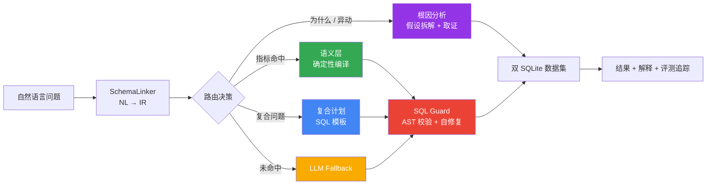

# CertusBI

<div align="center">

### 语义驱动的多智能体 ChatBI 与数据洞察系统

**把自然语言问题转化为可信 SQL、可解释归因和可验证的数据结论。**

[](https://www.python.org/)
[](https://fastapi.tiangolo.com/)
[](https://langchain-ai.github.io/langgraph/)
[](https://react.dev/)
[](https://sqlite.org/)
[](https://github.com/tobymao/sqlglot)

</div>

---

## 为什么是 CertusBI

大多数 NL2SQL 项目把自然语言直接交给 LLM 生成 SQL，但这会带来指标口径漂移、JOIN 路径失控、结果可执行却不可信等问题。

CertusBI 的核心原则是：**能确定的，不交给概率。** 系统将问题先解析为结构化中间表示（IR），对已定义业务指标走语义层确定性编译；对复杂复合分析走计划模板；对陌生问题才降级到 LLM 生成，并通过 SQL 守卫、字段级评测与全链路观测构成闭环。



## 项目亮点

| 高频方向 | 核心实现 | 设计价值 |
|---|---|---|
| 记忆系统 | 语义 / 情节 / 程序性三级长期记忆 + Redis 会话快照 + PostgreSQL 持久化 | 既保留稳定用户偏好，又不把一次性上下文无限塞进 Prompt |
| 上下文工程 | 工具结果两级截断、近轮保留、压缩前 Transcript 归档到 `ContextStore`、`recall_context` 按关键词延迟加载 | 将上下文截断从“直接丢信息”改为“可检索的按需回忆” |
| RAG + Rerank | 父子块切分、Milvus 稠密向量 + BM25 稀疏检索 + RRF 融合 + rerank | 兼顾召回率、关键词精确性与最终上下文完整度，并具备降级路径 |
| Agent 编排 | LangGraph Supervisor / ReAct / Coordinator / Reflection | 简单问题走快速路径，工具复合问题走循环，跨域任务拆解后并行执行 |
| MCP 与 Skills | 工具按 MCP 概念模型做发现、LLM 重排、参数推断与调用路由；Skills 动态注入流程知识 | 把模型能力与外部能力解耦，新增工具或流程不必改 Agent 主链路 |
| Schema 索引 | Domain → Table → Column 三级收敛，融合 DDL、业务定义和 SQL 示例的混合检索 | 降低大 Schema 噪声，减少选错表列，并为动态 Few-shot 提供样例 |
| NL2SQL 优化 | `MetricPlanCompiler`：14 指标、18 维度、NL → IR → 确定性 SQL；6 类复合计划 | 已定义口径不交给 LLM 概率生成，保证 JOIN、聚合和业务指标可审计 |
| SQL Guard | sqlglot AST 校验 → 执行反馈自修复 → 空结果 / LIMIT / NULL / 比率合理性检查 | 防止“可执行但不可用”的静默错误，并阻断非只读 SQL |
| 评测体系 | 域内、复合、泛化、Spider 四套评测；EX + 表命中率 + 行召回率 + 字段准确率 | 区分域内系统收益和开放域模型能力，失败可定位到表、行或单元格 |
| 可观测与审计 | JSONL Trace、错误 / 慢查询采样、IR / SQL / 路由链路记录 | 让每一次结论可复核，线上问题可定位 |

## 可量化结果

### 四套独立评测

| 评测集 | 题数 | EX | 覆盖目标 |
|---|---:|---:|---|
| 域内端到端集 | 15 | **100%（15/15）** | 语义层、复合计划、LLM fallback 混合链路 |
| 复合专项集 | 12 | **100%（12/12）** | 6 类复合计划及每类两种自然语言改写 |
| 域内泛化集 | 10 | **80%（8/10）** | 未见过的业务表述泛化能力 |
| Spider dev 全 20 库 | 99 | **80.8%（80/99，严格判等，2026-08-28 轮）** | 真实开放域 SQLite 数据、无语义层的 LLM 裸能力 |

### Spider 开放域四项核心指标

| 指标 | 结果 | 衡量的问题 |
|---|---:|---|
| EX（执行准确率，严格判等，对外口径） | **80.8%（80/99）** | 结果集与 Gold SQL 完全一致（2026-08-28 轮） |
| 部分正确（Jaccard ≥ 0.8，不计入 EX） | 4 题 | 结果集高度重叠但不完全相等（宽松参考 84.8%） |
| 表命中率（Schema Linking） | **97.0%（96/99）** | 是否选择了正确的表（08-25 详细评测轮） |
| 行召回率（Field Recall） | **0.851** | Gold 中应返回的行是否被查全（08-25 详细评测轮） |
| 字段准确率（Cell Accuracy） | **0.898** | 已匹配行中的单元格值是否正确（08-25 详细评测轮） |

这四项指标对应一条完整验证链路：**选对表 → 查全行 → 值准确 → 整体对**。Spider 评测覆盖 20 个异构数据库、99 个问题，其中最新一轮（2026-08-28）**7 个数据库 EX 满分**；zero-shot、严格判等口径下 EX 为 **80.8%（80/99）**，另有 4 题 Jaccard ≥ 0.8 的部分正确（宽松参考 84.8%）。字段级三项指标来自 08-25 详细评测轮（该轮严格 EX 78.8%），用于失败定位与优化方向判断。完整数据见 [`docs/eval_spider.json`](docs/eval_spider.json)，口径版本见 [`docs/EVAL_VERSIONS.md`](docs/EVAL_VERSIONS.md)，评测报告见 [`docs/evaluation_report.md`](docs/evaluation_report.md)。

## 核心能力

### 1. 可信 Text2SQL：从自然语言到确定性 SQL

```text
问题：最近三个月各品类销售额排名

SchemaLinker
  └─> IR: {
        metrics: [revenue],
        dimensions: [product_category],
        filters: [last_3_months],
        sort: revenue_desc
      }

MetricPlanCompiler
  └─> 选择指标定义、正确 JOIN 路径、GROUP BY 与排序规则
  └─> 输出可审计 SQL
```

语义层命中时，SQL 由编译器生成而非 LLM 即兴生成；未命中的开放问题才使用 LLM fallback。这使业务口径、关联路径和降级原因都可追溯。

### 2. SQL Guard：让“能执行”不等于“可信”

SQL Guard 分为三层：静态阶段用 `sqlglot` 解析 AST，拒绝写操作、无效表列与不兼容函数；执行阶段将数据库错误连同 Schema 反馈给模型，最多进行两轮自修复；结果阶段检查空结果、Top-N 与 LIMIT 一致性、NULL 占比和异常比率，识别“SQL 成功但结论不可用”的静默错误。

### 3. 评测与可观测：让每一次结论可复核

系统通过域内、复合、泛化和 Spider 四套独立评测区分工程体系收益与开放域泛化能力；线上 Trace 记录问题、Schema Linking IR、最终 SQL、执行耗时和错误上下文。EX 用于最终结果判定，表命中率、行召回率和字段准确率用于定位失败发生在选表、结果行还是单元格值。

## 数据与技术架构

| 类别 | 选型与规模 |
|---|---|
| 域内数据 | Olist 巴西电商：14,747 笔订单、9 张表、8.9MB；Chinook 数字媒体：11 张表、984KB |
| 开放域数据 | Spider dev：20 个异构 SQLite 数据库、99 题评测样本 |
| 多智能体编排 | LangGraph StateGraph：Supervisor、ReAct、Coordinator、Reflection |
| 后端 | Python + FastAPI + LangChain / LangGraph |
| 前端 | Vite + React 19 + TypeScript + ECharts |
| SQL 基础设施 | SQLite ATTACH 跨库查询 + sqlglot 26.33.0 |
| 检索与记忆 | Milvus、BM25 稀疏检索、RRF 融合、rerank、Redis、PostgreSQL |
| 工程规模 | 12 个 ChatBI 核心模块、4 组评测脚本、36 项回归测试 |

## 项目结构

```text
CertusBI/
├── backend/
│   ├── chatbi/                 # ChatBI 核心：语义层、路由、SQL Guard、根因、字段评测
│   ├── core/                   # LangGraph 编排、多 Agent 协作、上下文管理
│   ├── evaluation/             # 评测、自进化、在线监控
│   ├── rag/                    # 文档处理、混合检索、Embedding Provider
│   ├── memory/                 # 会话恢复与长期记忆
│   └── tools/                  # SQL 执行与工具注册
├── frontend/                   # React ChatBI 控制台（对话、评测、监控、审计等页面）
├── data/
│   ├── olist.sqlite            # 电商数据集
│   ├── chinook.sqlite          # 数字媒体数据集
│   └── spider/                 # Spider 原始 SQLite 数据库
├── scripts/
│   ├── eval_chatbi.py          # 域内端到端评测
│   ├── eval_compound.py        # 复合指标专项评测
│   ├── eval_generalization.py  # 域内泛化评测
│   └── eval_spider.py          # Spider 开放域评测
├── tests/                      # 36 项回归测试
└── docs/                       # 架构、评测与数据口径说明
```

## 快速开始

### 1. 准备环境

要求 Python 3.12+、Node.js 20+；如需运行完整 RAG、记忆和多智能体服务，还需 Docker Compose。

```bash
git clone https://github.com/zjt0817/CertusBI.git
cd CertusBI

python3 -m venv .venv
source .venv/bin/activate
pip install -r requirements.txt
```

复制并填写本地环境变量文件。至少配置一个 OpenAI 兼容 LLM 服务；Embedding/Rerank 可以按需启用。

```bash
cp .env.example .env
```

```env
# Text2SQL / Agent 模型
DASHSCOPE_API_KEY=your_api_key
BASE_URL=https://api.deepseek.com/v1
AGENT_BASE_MODEL=deepseek-chat

# 可选：Embedding 与 rerank
EMBEDDING_PROVIDER=siliconflow
EMBEDDING_MODEL=BAAI/bge-m3
EMBEDDING_API_KEY=your_embedding_api_key
```

### 2. 启动后端与前端

```bash
# Terminal 1：FastAPI 后端
cd backend
PYTHONPATH=. uvicorn main:app --reload --port 8000
```

```bash
# Terminal 2：React 前端
cd frontend
npm install
npm run dev
```

后端 API 文档默认位于 `http://localhost:8000/docs`；前端开发服务器地址以 Vite 输出为准。

### 3. 使用 Docker 启动完整基础设施（可选）

Docker Compose 会启动 Milvus、etcd、MinIO、PostgreSQL、Redis 与 FastAPI 后端。构建镜像时会自动生成 SQLite 数据集（`scripts/gen_olist_db.py`，固定 seed 可复现），无需提前准备 `data/` 目录。

```bash
docker compose up -d
docker compose ps
```

> Chinook（`data/chinook.sqlite`）与 Spider（`data/spider/spider_data/`）为可选公开数据集：缺失时后端仅启用 Olist 主库并输出告警，不影响服务启动。

## 运行评测

所有评测脚本输出原始 JSON 到 `docs/`，便于复核每一个问题的 Gold SQL、Agent SQL、执行结果与字段级指标。

```bash
# 进入项目根目录，确保 .env 中已配置 LLM
PYTHONUNBUFFERED=1 .venv/bin/python scripts/eval_chatbi.py
PYTHONUNBUFFERED=1 .venv/bin/python scripts/eval_compound.py
PYTHONUNBUFFERED=1 .venv/bin/python scripts/eval_generalization.py
PYTHONUNBUFFERED=1 .venv/bin/python scripts/eval_spider.py
```

> Spider 评测默认会调用 LLM，并使用本地 `data/spider/spider_data/` 的真实数据库；首次运行前请确认数据文件已经准备完成。

## 关键文档

| 文档 | 内容 |
|---|---|
| [`docs/CHATBI_UPGRADE.md`](docs/CHATBI_UPGRADE.md) | ChatBI 演进过程、设计细节与失败案例归因 |
| [`docs/evaluation_report.md`](docs/evaluation_report.md) | 四套评测报告与 Spider 全库结果 |
| [`docs/eval_spider.json`](docs/eval_spider.json) | 99 个 Spider 样本的可复核原始评测数据 |
| [`docs/EVAL_VERSIONS.md`](docs/EVAL_VERSIONS.md) | 评测口径版本与数字来源说明 |

## 设计取舍

CertusBI 不宣称在任何陌生数据库上都能达到域内确定性编译的效果。域内 100% EX 来自“语义层 + SQL Guard + 评测驱动迭代”的系统设计；Spider 严格口径 80.8%（80/99，2026-08-28 轮）则刻画了脱离定制语义层后的开放域零样本能力。将两者分开报告，是为了区分工程体系收益与底座模型能力，也让后续优化有明确方向。

---

<div align="center">

**CertusBI — 连接业务语义与数据决策的智能分析中枢。**

</div>
